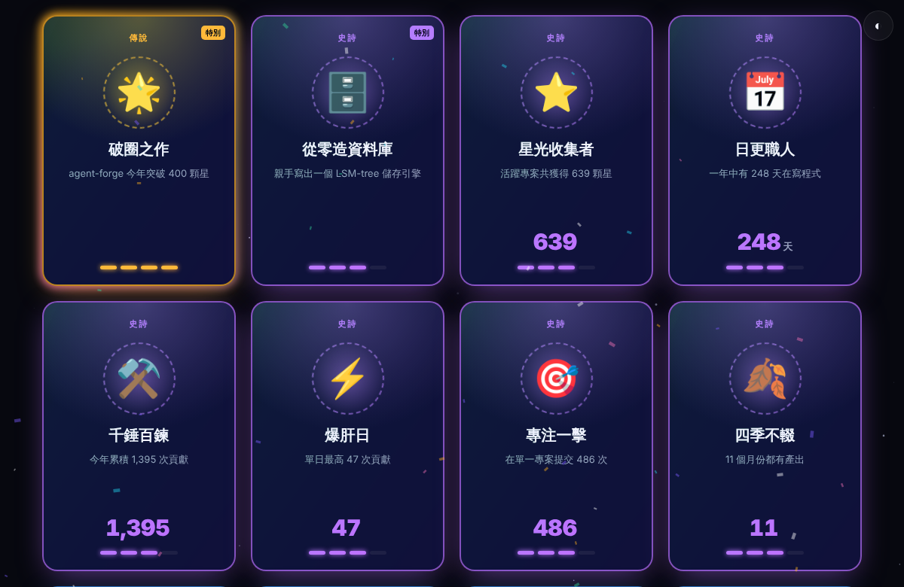

<div align="center">


# RecapLion

**An animated GitHub year in review — for anyone, with any AI agent.**

**English** · [繁體中文](README.zh-TW.md)

[🌐 Website & live demo](https://malilion.github.io/RecapLion/)

[🦁 malilion’s real 2026 review · 繁體中文](https://malilion.github.io/RecapLion/demo/malilion-2026/)

</div>

RecapLion looks back at what you built on GitHub this year — the projects and systems you shipped
and the achievements you unlocked — and turns it into an **animated web page** plus **animated
achievement cards** you can put on your profile.


## ✨ Features

- **Year in numbers** — contributions, commits, PRs, reviews, active days, longest streak, with count-up animation
- **Heatmap & charts** — wave-in contribution heatmap, monthly bars, commit-hour clock
- **Language map** — weighted by your commits per project
- **Project cards** — your agent reads READMEs and commits, then writes a category, pitch and highlights for each project
- **Achievement cards** — 19 built-in achievements × 4 tiers (common / rare / epic / legendary) with card-deal flips, 3D tilt, holo shine, glowing legendary borders and confetti
- **Special achievements** — awarded by the agent from evidence the metrics can't see ("built a database from scratch", "shipped on five platforms")
- **Next goals** — progress bars for what you're about to unlock
- **Animated SVG cards** — one per achievement plus a summary card, embeddable in a profile README
- English and Traditional Chinese, a single HTML file, light & dark themes, phone layout, `prefers-reduced-motion`
- **Python standard library only** — no `pip install`, no Node

| Heatmap & charts | Projects |
|---|---|
|  |  |



<p>




</p>


## 🤖 Works with your agent

RecapLion is an [Agent Skill](https://agentskills.io): a folder with a `SKILL.md`, the open format
read by Claude Code, OpenAI Codex, Gemini CLI, GitHub Copilot, Cursor and many other agents. The
repository also ships an [`AGENTS.md`](AGENTS.md) for agents that read that file instead.

### Install

**Install script (any agent, auto-detect)**

```bash
curl -fsSL https://raw.githubusercontent.com/malilion/RecapLion/main/install.sh | sh
```

It detects Claude Code (`~/.claude/skills`) and Codex / other Agent Skills clients
(`~/.agents/skills`). You can also pick targets or use any folder:

```bash
sh install.sh claude codex
```

```bash
sh install.sh --dir ~/path/to/your/agent/skills
```

**Claude Code plugin**

```
/plugin marketplace add malilion/RecapLion
```

```
/plugin install recaplion@recaplion
```

**Skills CLI** (if you use it)

```bash
npx skills add malilion/RecapLion
```

**Manual** — copy `skills/github-year-review/` into your agent's skills folder. The folder is self-contained.

### Use

Ask your agent:

> Make my 2026 GitHub year in review. My username is `octocat`, timezone Europe/Berlin.

The agent runs the scripts, reads your projects, writes the story and special achievements, and
renders the page. See [`SKILL.md`](skills/github-year-review/SKILL.md) for the full workflow.

## 🧑‍💻 No agent? One command

```bash
git clone https://github.com/malilion/RecapLion.git
```

```bash
python3 RecapLion/skills/github-year-review/scripts/recap.py --user <your-login> --tz Europe/Berlin
```

It first asks which repositories to cover (or pass `--scope` to skip the question):

| Choice | Covers | Needs |
|---|---|---|
| `--scope public` | Public repositories only. Nothing private, not even anonymous counts. Safe to share. | Nothing; a token just makes it faster and more complete |
| `--scope all` | Public **and** your own private repositories | A GitHub token for that same account (`gh auth login`) |

Open `recap-<login>-<year>/year-review.html`. You get every stat, chart and built-in achievement.
For project stories and special achievements, write a
[`narrative.json`](skills/github-year-review/references/narrative-schema.md) (by hand or with any
AI) and re-run with `--narrative narrative.json --skip-fetch`. Use `--lang zh` for Traditional Chinese.

### GitHub token

The token is read from `--token`, `GITHUB_TOKEN` / `GH_TOKEN`, or `gh auth token`; the easiest way
is `gh auth login`. With `--scope public` a token gives exact GraphQL data, filtered to public
repositories. Without a token RecapLion uses the public search API instead: it takes a few minutes
because of rate limits, reviews are approximate and releases unknown.

### Including your private repositories (`--scope all`)

```bash
python3 RecapLion/skills/github-year-review/scripts/recap.py --user <your-login> --tz Asia/Taipei --scope all
```

The token must belong to `<your-login>` and have access to the private repositories. This mode
paginates the repository inventory, private default-branch commits, authored PRs/issues and
reviews. If GitHub's calendar omits private activity, RecapLion reconstructs it and labels the
combined total in the report; activity already in the calendar is not added twice. Failures stop
with an error instead of silently producing a public-only report.

This report is meant for you. To share it, add `--exclude-private`: private activity still counts
in totals, charts and achievements, but private repository names, descriptions and commit subjects
are left out. Keep `raw.json` and `analysis.json` private, and review any custom narrative before
sharing — free-form text is not redacted automatically. `--skip-fetch` never mixes scopes: a public
run refuses a cache that contains private data. See [`SKILL.md`](skills/github-year-review/SKILL.md)
for coverage and sampling limitations.

### Auto-refresh your profile

Copy [`examples/github-action/recaplion.yml`](examples/github-action/recaplion.yml) into
`.github/workflows/` of your `<you>/<you>` profile repository. It regenerates the cards every week;
embed them with ``.

### Try it offline

```bash
cd RecapLion/skills/github-year-review
python3 scripts/make_sample_raw.py -o /tmp/raw.json
python3 scripts/analyze.py /tmp/raw.json -o /tmp/analysis.json
python3 scripts/render.py /tmp/analysis.json --narrative references/example-narrative.json -o /tmp/year-review.html --cards-dir /tmp/cards
```

Or open [`examples/sample/year-review.html`](examples/sample/year-review.html) (fictional user `demo-dev`).

## 🏅 Achievements

Full thresholds: [`references/achievements.md`](skills/github-year-review/references/achievements.md).
Add your own by editing `ACHIEVEMENTS` in `scripts/analyze.py`.

| | Achievement | Based on |
|---|---|---|
| 🔥 | Eternal Flame | Longest streak |
| ⚒️ | Forged in Commits | Total contributions |
| 📅 | Daily Builder | Active days |
| 🌱 | Genesis | New repositories |
| 🗣️ | Polyglot | Languages used |
| 🔀 | Merge Master | PRs merged |
| 🧭 | Open Source Voyager | PRs merged into others' repositories |
| 🛡️ | Gatekeeper | Code reviews |
| 🐞 | Bug Hunter | Issues opened |
| ⭐ | Stargazer | Stars on your repositories |
| ⚡ | Overdrive | Busiest single day |
| 🦉 | Night Owl | Share of commits 0–5 AM |
| 🐦 | Early Bird | Share of commits 5–9 AM |
| 🏕️ | Weekend Warrior | Share of contributions on weekends |
| 🗓️ | Perfect Month | Months with no empty day |
| 🎯 | Deep Focus | Commits to a single repository |
| 🧵 | Multi-threaded | Repositories with commits |
| 🍂 | All Seasons | Active months |
| 🚀 | Shipper | Releases published |

## ❓ FAQ

### If someone installs this skill, does it collect everything, including private repositories?

No. Private data is never collected by default, and nobody can ever reach **someone else's**
private repositories.

**1. The user is asked first**

| How it runs | What happens |
|---|---|
| Through an AI agent (Claude Code, Codex, …) | `SKILL.md` tells the agent to ask "public repositories only, or include your private ones?" before collecting anything |
| `recap.py` in a terminal | A menu asks you to choose 1 (public) or 2 (all) |
| Automation (GitHub Action, CI) | Nobody can be asked, so it collects **public data only**; the Action template uses `RECAP_SCOPE: public` |

**2. "All" only works for your own account**
- `--scope all` requires the token's owner to be the same account as `--user`. The script checks
  this and stops with an error otherwise.
- So if someone runs RecapLion for `malilion`, they only see malilion's public repositories. They
  can never get the private ones, because they don't have malilion's token.
- Likewise, choosing "all" only ever covers the private repositories **you** can access.

**3. Your data stays on your machine**
- RecapLion only talks to GitHub's API. It never sends data to the author or to any other server.
- Reports are written to your own folder; whether to share them is up to you.

### What do I get when I download the skill?

- **`install.sh` or a manual copy** — only the `skills/github-year-review/` folder: scripts and
  instructions, no one's data.
- **Claude Code `/plugin install`** — the whole repository, including the website and the demo
  reports in `docs/`. Those are already public on the website and contain public repositories only.

### Public-only mode: does it hide private work from the totals too?

Yes. With `--scope public`, private activity is left out completely — not even as anonymous
counts on the calendar. (GitHub itself would count your private work when you use your own token,
so RecapLion rebuilds the year from public contributions only.)

## 📁 Structure

```
skills/github-year-review/      the Agent Skill (self-contained, copy anywhere)
  SKILL.md                      workflow for agents
  scripts/
    recap.py                    one-shot CLI: fetch → analyze → render
    fetch_github_year.py        GraphQL data source
    private_source.py           paginated private activity and missing-calendar reconstruction
    public_source.py            public-only GraphQL data (--scope public)
    search_source.py            search API data source (no token needed)
    analyze.py                  stats + achievement evaluation
    render.py                   HTML page + SVG cards
    make_sample_raw.py          fictional demo data
  assets/report_template.html   animated page template
  references/                   achievements, narrative schema, example narrative
AGENTS.md                       instructions for AI coding agents
install.sh                      installer for Claude Code / Codex / any skills folder
.claude-plugin/                 Claude Code plugin + marketplace manifests
examples/                       sample output, GitHub Action
```

## License

MIT © malilion
