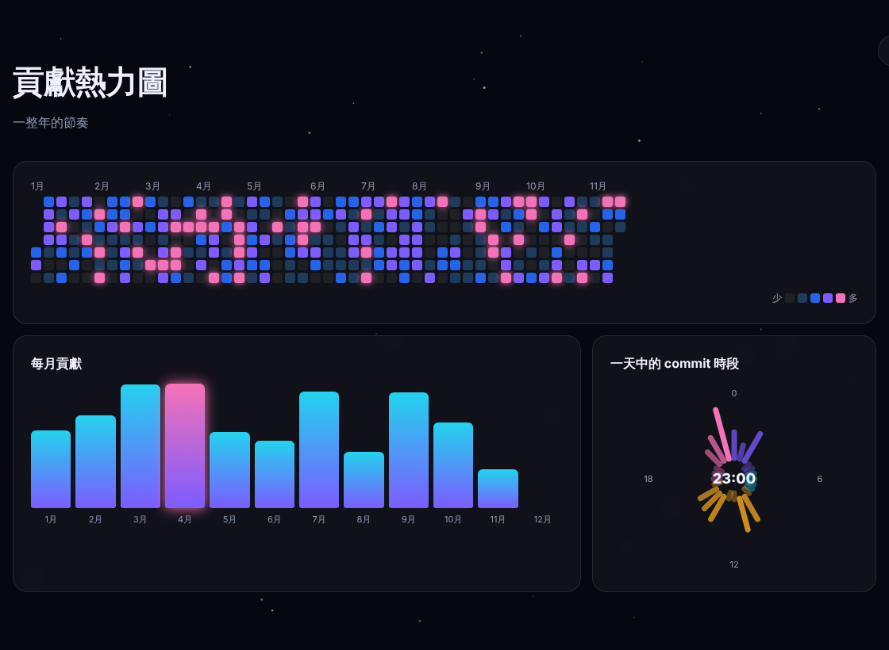
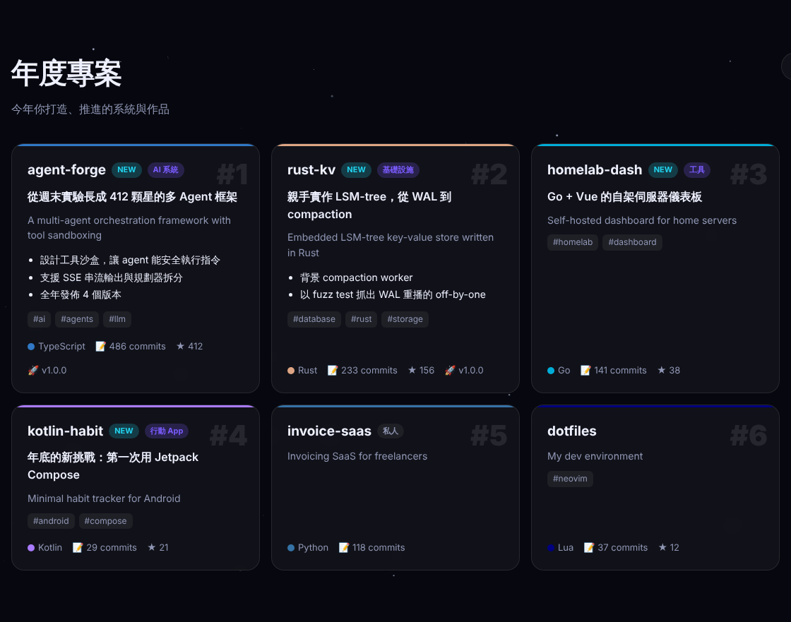

# 🏆 GitHub Achievement Skill — GitHub 年度回顧

一個 Claude Code **Skill**：回顧你今年在 GitHub 上做了哪些專案與系統、達成了哪些成就，
產生一個**有動畫的年度回顧網頁**，以及可以放進個人 README 的**動畫成就卡**。


## ✨ 功能

- **年度數字**：總貢獻、commits、PR、code review、活躍天數、最長連續天數⋯⋯（數字滾動動畫）
- **貢獻熱力圖**：一格一格浮現的波浪動畫，加上每月長條圖、commit 時段時鐘圖
- **語言版圖**：依你在每個專案的 commit 量加權
- **年度專案卡**：Claude 會讀 README 與 commit 紀錄，替每個專案寫分類、一句話介紹和重點
- **成就卡**：19 種內建成就 × 4 種稀有度（普通／稀有／史詩／傳說），
  發牌翻面動畫、3D 傾斜、全息閃光、傳說級發光邊框與彩帶；點擊翻面看門檻與進度
- **特別成就**：Claude 根據專案內容頒發數據看不出來的成就（例如「從零造資料庫」「首次上線產品」）
- **下一個目標**：快要解鎖的成就與進度條
- **動畫 SVG 成就卡**：每個成就一張 + 一張年度總結卡，可以直接嵌入 GitHub 個人頁
- 單一 HTML 檔、亮／暗主題、手機版排版、支援 `prefers-reduced-motion`

| 熱力圖與圖表 | 年度專案 |
|---|---|
|  |  |


**動畫 SVG 成就卡**（可放進個人 README）：

<p>



</p>



## 📦 安裝

### 方式一：當作 Claude Code plugin 安裝
在 Claude Code 中執行：

```
/plugin marketplace add malilion/Github-Achievement-Skill
```

```
/plugin install github-achievement@github-achievement-skill
```

### 方式二：直接複製 skill 資料夾

```bash
git clone https://github.com/malilion/Github-Achievement-Skill.git
```

```bash
cp -r Github-Achievement-Skill/skills/github-year-review ~/.claude/skills/
```

## 🚀 使用

在 Claude Code 裡直接說：

> 幫我做一份 2026 年的 GitHub 年度回顧，帳號是 `your-name`，要有成就卡

Claude 會依照 [`SKILL.md`](skills/github-year-review/SKILL.md) 的流程：

1. `fetch_github_year.py` — 透過 GitHub GraphQL API 抓一整年的貢獻、專案與 commit 樣本
2. `analyze.py` — 計算統計、專案列表、語言比例並判定成就
3. **Claude 閱讀專案 README 與 commit**，寫出 `narrative.json`（標題、專案介紹、特別成就、總結）
4. `render.py` — 產生 `year-review.html` 與 `cards/*.svg`

### GitHub Token

有 token 才能拿到完整資料（貢獻日曆、PR、review、私人貢獻數）。依序讀取：
`--token` 參數 → `GITHUB_TOKEN` / `GH_TOKEN` 環境變數 → `gh auth token`。
最簡單的方式是先執行 `gh auth login`。沒有 token 或 GraphQL 無法連線時，會自動改用公開的 Search API（只含公開活動，因搜尋速率限制需要幾分鐘）。

### 手動執行

```bash
cd skills/github-year-review
python3 scripts/fetch_github_year.py --user your-name --year 2026 --tz Asia/Taipei -o raw.json
python3 scripts/analyze.py raw.json -o analysis.json            # 公開分享可加 --exclude-private
# （選用）撰寫 narrative.json，格式見 references/narrative-schema.md
python3 scripts/render.py analysis.json --narrative narrative.json -o year-review.html --cards-dir cards
```

只需要 Python 3.9+，不必安裝任何套件。

### 沒有 token 也想先看看？

```bash
python3 examples/make_sample_raw.py -o /tmp/raw.json
python3 skills/github-year-review/scripts/analyze.py /tmp/raw.json -o /tmp/analysis.json
python3 skills/github-year-review/scripts/render.py /tmp/analysis.json \
  --narrative examples/sample/narrative.json -o /tmp/year-review.html --cards-dir /tmp/cards
```

或直接打開 [`examples/sample/year-review.html`](examples/sample/year-review.html)（虛構使用者 `demo-dev` 的範例）。

## 🏅 成就一覽

完整門檻見 [`references/achievements.md`](skills/github-year-review/references/achievements.md)。

| | 成就 | 條件 |
|---|---|---|
| 🔥 | 不滅之火 | 最長連續貢獻天數 |
| ⚒️ | 千錘百鍊 | 年度總貢獻 |
| 📅 | 日更職人 | 活躍天數 |
| 🌱 | 創世者 | 今年新建的 repo |
| 🗣️ | 多語通 | 使用的程式語言數 |
| 🔀 | 合併大師 | 被合併的 PR |
| 🧭 | 開源旅人 | 合併進別人專案的 PR |
| 🛡️ | 守門人 | Code Review 次數 |
| 🐞 | 除錯獵人 | 開 Issue 次數 |
| ⭐ | 星光收集者 | 自己專案的星星數 |
| ⚡ | 爆肝日 | 單日最高貢獻 |
| 🦉 | 夜貓子 | 凌晨 0–5 點 commit 比例 |
| 🐦 | 晨型人 | 早上 5–9 點 commit 比例 |
| 🏕️ | 週末戰士 | 週末貢獻比例 |
| 🗓️ | 全勤月 | 每天都有貢獻的月份 |
| 🎯 | 專注一擊 | 單一專案 commit 數 |
| 🧵 | 多線並行 | 有 commit 的 repo 數 |
| 🍂 | 四季不輟 | 有產出的月份數 |
| 🚀 | 出貨達人 | 發佈的 Release 數 |

想新增成就，編輯 `scripts/analyze.py` 裡的 `ACHIEVEMENTS` 清單即可。

## 📁 結構

```
.claude-plugin/              plugin 與 marketplace 設定
skills/github-year-review/
  SKILL.md                   Claude 執行流程
  scripts/
    fetch_github_year.py     抓 GitHub 資料
    analyze.py               統計與成就判定
    render.py                產生 HTML 與 SVG 卡片
  assets/report_template.html  動畫網頁模板
  references/                成就門檻、narrative 格式
examples/                    範例資料與產出
```

## License

MIT © malilion
