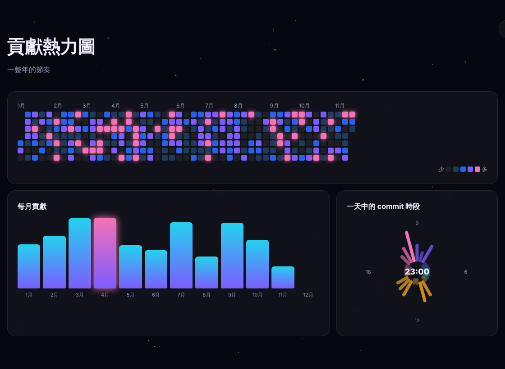

<div align="center">

# 🦁 RecapLion 回顧獅

**任何人都能用、任何 AI agent 都能跑的 GitHub 年度回顧。**

[English](README.md) · **繁體中文**

[🌐 介紹網頁與線上 Demo](https://malilion.github.io/RecapLion/?lang=zh)

[🦁 malilion 的 2026 真實年度回顧](https://malilion.github.io/RecapLion/demo/malilion-2026/)

</div>

RecapLion 會回顧你今年在 GitHub 做了哪些專案與系統、達成了哪些成就，產生一個**有動畫的年度回顧網頁**，
以及可以放進個人頁的**動畫成就卡**。


## ✨ 功能

- **年度數字**：總貢獻、commits、PR、code review、活躍天數、最長連續天數，數字會滾動跑出來
- **熱力圖與圖表**：一格一格浮現的貢獻熱力圖、每月長條圖、commit 時段時鐘圖
- **語言版圖**：依你在每個專案的 commit 量加權
- **年度專案卡**：agent 會讀 README 與 commit 紀錄，替每個專案寫分類、一句話介紹和重點
- **成就卡**：19 種內建成就 × 4 種稀有度（普通／稀有／史詩／傳說），發牌翻面、3D 傾斜、全息閃光、傳說級發光邊框與彩帶
- **特別成就**：agent 根據專案內容頒發數據看不出來的成就，例如「從零造資料庫」「全平台出貨」
- **下一個目標**：快要解鎖的成就與進度條
- **動畫 SVG 成就卡**：每個成就一張，另有年度總結卡，可以直接放進 GitHub 個人頁
- 繁體中文與英文、單一 HTML 檔、亮暗主題、手機版排版、支援 `prefers-reduced-motion`
- **只用 Python 標準函式庫**：不必 `pip install`，也不需要 Node

| 熱力圖與圖表 | 年度專案 |
|---|---|
|  |  |


<p>



</p>


## 🤖 支援的 AI agent

RecapLion 採用開放的 [Agent Skills](https://agentskills.io) 格式（一個含 `SKILL.md` 的資料夾），
Claude Code、OpenAI Codex、Gemini CLI、GitHub Copilot、Cursor 等 agent 都能使用。
repo 另外附上 [`AGENTS.md`](AGENTS.md)，給讀取這個檔案的 agent。

### 安裝

**一鍵安裝（任何 agent，自動偵測）**

```bash
curl -fsSL https://raw.githubusercontent.com/malilion/RecapLion/main/install.sh | sh
```

會自動偵測 Claude Code（`~/.claude/skills`）與 Codex／其他支援 Agent Skills 的工具（`~/.agents/skills`）。
也可以指定目標或任意資料夾：

```bash
sh install.sh claude codex
```

```bash
sh install.sh --dir ~/path/to/your/agent/skills
```

**Claude Code plugin**

```
/plugin marketplace add malilion/RecapLion
```

```
/plugin install recaplion@recaplion
```

**Skills CLI**（如果你有在用）

```bash
npx skills add malilion/RecapLion
```

**手動安裝**：把 `skills/github-year-review/` 整個資料夾複製到 agent 的 skills 資料夾即可，它不依賴 repo 其他檔案。

### 使用

對 agent 說：

> 幫我做 2026 年的 GitHub 年度回顧，帳號是 `octocat`，時區 Asia/Taipei，要有成就卡。

agent 會執行腳本、閱讀你的專案、寫出年度故事與特別成就，再產生網頁。完整流程見
[`SKILL.md`](skills/github-year-review/SKILL.md)。

## 🧑‍💻 不用 AI 也能跑

```bash
git clone https://github.com/malilion/RecapLion.git
```

```bash
python3 RecapLion/skills/github-year-review/scripts/recap.py --user <你的帳號> --tz Asia/Taipei --lang zh
```

打開 `recap-<帳號>-<年份>/year-review.html` 即可，所有統計、圖表與內建成就都會有。
想加上專案故事與特別成就，可以自己或請任何 AI 寫一份
[`narrative.json`](skills/github-year-review/references/narrative-schema.md)，
再加上 `--narrative narrative.json --skip-fetch` 重跑。

### GitHub token

有 token 才有完整資料（貢獻日曆、review、release、私人貢獻數）。讀取順序是 `--token`、
`GITHUB_TOKEN` / `GH_TOKEN`、`gh auth token`，最簡單是先執行 `gh auth login`。
沒有 token 時會自動改用公開的 Search API：只含公開活動，而且因為速率限制需要幾分鐘。

### 自動更新個人頁

把 [`examples/github-action/recaplion.yml`](examples/github-action/recaplion.yml) 放進你的個人頁 repo
（`<你>/<你>`）的 `.github/workflows/`，每週會自動重新產生成就卡，
在 README 用 `` 嵌入即可。

### 先看範例

```bash
cd RecapLion/skills/github-year-review
python3 scripts/make_sample_raw.py -o /tmp/raw.json
python3 scripts/analyze.py /tmp/raw.json -o /tmp/analysis.json
python3 scripts/render.py /tmp/analysis.json --narrative references/example-narrative.json -o /tmp/year-review.html --cards-dir /tmp/cards
```

或直接打開 [`examples/sample/year-review.html`](examples/sample/year-review.html)（虛構使用者 `demo-dev` 的範例）。

## 🏅 成就一覽

完整門檻見 [`references/achievements.md`](skills/github-year-review/references/achievements.md)。
想新增成就，編輯 `scripts/analyze.py` 裡的 `ACHIEVEMENTS` 清單即可。

| | 成就 | 條件 |
|---|---|---|
| 🔥 | 不滅之火 | 最長連續貢獻天數 |
| ⚒️ | 千錘百鍊 | 年度總貢獻 |
| 📅 | 日更職人 | 活躍天數 |
| 🌱 | 創世者 | 今年新建的 repo |
| 🗣️ | 多語通 | 使用的程式語言數 |
| 🔀 | 合併大師 | 被合併的 PR |
| 🧭 | 開源旅人 | 合併進別人專案的 PR |
| 🛡️ | 守門人 | Code Review 次數 |
| 🐞 | 除錯獵人 | 開 Issue 次數 |
| ⭐ | 星光收集者 | 自己專案的星星數 |
| ⚡ | 爆肝日 | 單日最高貢獻 |
| 🦉 | 夜貓子 | 凌晨 0–5 點 commit 比例 |
| 🐦 | 晨型人 | 早上 5–9 點 commit 比例 |
| 🏕️ | 週末戰士 | 週末貢獻比例 |
| 🗓️ | 全勤月 | 每天都有貢獻的月份 |
| 🎯 | 專注一擊 | 單一專案 commit 數 |
| 🧵 | 多線並行 | 有 commit 的 repo 數 |
| 🍂 | 四季不輟 | 有產出的月份數 |
| 🚀 | 出貨達人 | 發佈的 Release 數 |

## 📁 結構

```
skills/github-year-review/      Agent Skill 本體（可單獨複製使用）
  SKILL.md                      給 agent 的執行流程
  scripts/
    recap.py                    一鍵指令：抓資料 → 分析 → 產生
    fetch_github_year.py        GraphQL 資料來源
    search_source.py            Search API 資料來源（不需 token）
    analyze.py                  統計與成就判定
    render.py                   產生 HTML 與 SVG 卡片
    make_sample_raw.py          虛構範例資料
  assets/report_template.html   動畫網頁模板
  references/                   成就門檻、narrative 格式與範例
AGENTS.md                       給 AI coding agent 的說明
install.sh                      安裝到 Claude Code／Codex／任意 skills 資料夾
.claude-plugin/                 Claude Code plugin 與 marketplace 設定
examples/                       範例產出、GitHub Action
```

## 授權

MIT © malilion
